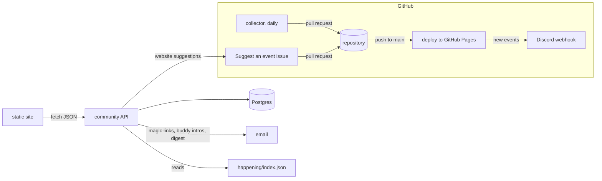

# Beyond v1: what Tasmania Welcome should become

Research notes and recommendations, November 2026. Written for the hellotas team; everything marked **built** is in
this branch.

## The short answer

Don't build Facebook. Build thin social features on top of the things the site is already good at: events, the
arrival journey and students' stories. Every feature below either helps a new student turn up to their first
event or community activity (belonging), or helps them get local experience and contacts (employability). Those are
the two problems the evidence points at, and the two the site already works on.

| | Feature | Problem it targets | Status |
|---|---|---|---|
| 1 | Automatic event collection | events are scattered; students find out late | **built** (`collector/`) |
| 2 | Calendar subscription and a weekly email digest | "I found out after it finished"; teachers re-posting reminders | **built** |
| 3 | Event buddies: "Don't go alone" | walking into a room of strangers is the hardest step | **built** |
| 4 | Interested / going counts, and a personal "events I went to" record | social proof; a record to put on a CV | **built** |
| 5 | Kickstart checklist with saved progress | the first weeks are a long, stressful to-do list | **built** |
| 6 | Wish Wall and Achievement Wall (upstream #24) | organisers can't see demand; newcomers can't see people like them succeeding | **built** |
| 7 | Opportunities board with work-rights labels | most job boards ignore visa conditions | **built** |
| 8 | Suggest an event from the website | events only the students know about | **built** |
| 9 | Discord announcements (upstream #63) | supervisors sharing information with students | **built** (webhook) |
| 10 | Mentor office hours with graduates | the hidden job market runs on introductions | recommended next |
| 11 | General feed, direct messages, friend lists, groups | | **don't build** |
| 12 | Marketplace (rooms, furniture), employer or landlord ratings | | **don't build** |

## What the evidence says

**Isolation is common and it matters.** A national report commissioned by Medibank with Nous Group (29 October
2026; a survey of 2,296 international students at six universities, focus groups with more than 150 students and 42
staff interviews) found one in four international students struggling with their health and wellbeing, named
loneliness as a key warning sign, and found that students who feel they belong are more likely to seek help
([Medibank](https://www.medibank.com.au/livebetter/newsroom/post/new-report-reveals-wellbeing-gap-for-australias-international-students)).
An Allianz Partners survey found 18.7% of international students "always" lonely, and more than one in five had
considered withdrawing and going home because of it
([Allianz Partners](https://www.allianz-partners.com/en_AU/products/health/Are-international-students-finding-support-and-community-in-Australia.html)).
Figures elsewhere range from 18% to over 90% depending on how the question is asked, so this document uses only
the two sources above.

**International graduates find work later, and networks are a large part of why.** In the 2021 Graduate Outcomes
Survey, 43.0% of international undergraduates were in full-time work four to six months after graduating, against
68.9% of domestic graduates
([QILT, 2021 international report](https://qilt.edu.au/docs/default-source/default-document-library/2021-gos-international-reportb5ff0a7af7a54ca2a1ebc620f2570151.pdf)).
The gap has narrowed since, but it has not closed. Employers name visa status, communication and soft skills, and
lack of local work experience as the main barriers, and many prefer permanent residents
([Deakin University and IDP](https://www.deakin.edu.au/__data/assets/pdf_file/0010/365194/international-graduates-employment.pdf)).
Few international students have local networks, and many rely on online applications instead of networking
([The Conversation](https://theconversation.com/australia-wants-international-students-to-stay-and-work-after-graduation-they-find-it-difficult-for-4-reasons-191259)).
Industry events are where those networks start, which is why the site's events focus is right.

**Work rules shape what "an opportunity" means.** Student visa holders may work 48 hours a fortnight while their
course is in session and without limit in scheduled breaks (since 1 July 2023)
([summary](https://oneplanetmigrationlaw.com.au/immigration-blog/student-visa-work-hours-australia-2026/); check
the Department of Home Affairs before relying on it). Many graduate programs need more than that: the Tasmanian
State Service Graduate Development Program requires citizenship, permanent residency or a visa with full-time work
rights for the whole two-year program, and does not sponsor visas
([jobs.tas.gov.au](https://www.jobs.tas.gov.au/graduate_development_program/faqs)). A board that says up front who
can apply saves students wasted applications.

**Peer connection helps, though the evidence is not conclusive.** Buddy and peer-mentoring schemes for
international students report better adjustment and less loneliness, but the studies are mostly qualitative,
small or quasi-experimental (for example the rapid-acculturation mateship program, 126 mentees, in the
*International Journal of Intercultural Relations*, vol. 84). Belonging is associated with wellbeing, but that is
correlation. So the buddy feature is built cheaply and measured (how many people opt in, how many introductions
lead to both going) before anyone invests more.

## Why not a social network

1. **Cold start.** A few hundred ICT students a year is not enough people to keep a feed alive. Empty feeds look
   abandoned, and abandoned communities drive people away faster than none at all.
2. **Students already have their channels.** WeChat, WhatsApp, Discord, LinkedIn and MyLO. The site should point
   into them (Discord, upstream #63) rather than compete.
3. **Moderation is a job.** Direct messages and open posting need someone answering reports quickly, including at
   night, and the team are volunteers. Every feature here is moderated before it is public, or only shown to
   signed-in UTAS users, or both.
4. **Safety and privacy duties grow with every field collected.** The design keeps personal data to an email
   address, a display name and optional course and languages.

## What was built, and how it is designed

All of it is in two parts: the Hugo site stays a static site on GitHub Pages (fast, free, nothing to break), and
a small **community API** (`server/`) adds what a static site can't do. When the API isn't configured, the site
works exactly as before, and the community features simply don't appear.

### Accounts: magic links to UTAS email addresses

- No passwords. You type your email, get a one-time link (valid 20 minutes), and you are signed in for 30 days.
- Posting, buddies and saved progress need an address on an allowed domain (`utas.edu.au` by default), so
  everyone who can post is a real UTAS student or staff member. Reading is open to everyone.
- Stored: email, display name, optional course, optional languages, role (member, moderator, admin). Sign-in
  tokens and session tokens are stored only as hashes.
- People can download everything held about them and delete their account in one click.

### Events: interested, going, went, and buddies

- Anyone signed in can mark an event *interested* or *going*; the public sees only counts.
- After the event, *going* becomes *went*, and **My events** turns those into a short record ("Events I attended
  in 2026") to copy into a CV or LinkedIn.
- **Event buddies:** say you'd like company, optionally with a note ("first meetup, happy to meet outside at
  5:20"). Other signed-in students see the list (display names and notes, never email addresses). Asking someone
  sends them an email; only if they accept does each get the other's address. Nothing is ever exposed without
  both people agreeing.

### Walls (upstream #24)

- **Wish Wall:** "I wish there was a Rust meetup in Hobart", "a CV workshop before graduate applications open".
  Others add a *me too*. Organisers (GDG, ACS, the School of ICT) get a ranked list of what students want.
- **Achievement Wall:** first job, internship, hackathon placing, certification. Newcomers see people like them
  getting there; it also feeds the Stories page.
- Every post goes to a moderation queue first. Moderators approve or reject in one click on the site, and
  signed-in users can report anything.

### Opportunities board

Internships, graduate programs, casual jobs and volunteering, each with a **who can apply** label:
*student visa: fits 48 hours a fortnight*, *needs full-time work rights* (for example a graduate visa),
*citizens or permanent residents only*, or *anyone*. Posts come from signed-in users and are moderated; each has
a closing date and disappears after it.

### Kickstart checklist

The Step 1 page's to-do items (phone, bank, tax file number, transport, accommodation) as a checklist that remembers
what you ticked: in the browser for everyone, and across devices when signed in.

### Weekly digest

A Monday email with the coming fortnight's events, in English, Chinese or Nepali, filtered by topic. Subscribing
needs no account (double opt-in, one-click unsubscribe). It reads the site's own `happening/index.json`, so it never
disagrees with the site.

### Website suggestions

The **Suggest an event** form on the site sends the link and details to the API, which opens the same GitHub issue
as the issue form, so the collector handles both the same way and every suggestion is visible to the team.

## Recommended next

1. **Mentor office hours.** Recent graduates (several are already in the Stories page) offer two 20-minute slots
   a month through a booking link. This is the closest thing to fixing the network gap directly. It needs people
   more than code: a page listing mentors with Cal.com links is enough to start.
2. **A Discord server** with channels per topic, linked from the header (the icon is already there, waiting for a
   URL in `data/channels.yaml`). The webhook in `hugo.yml` already posts new events.
3. **Measure.** The API records counts that answer the questions that matter: how many students sign up per
   intake, how many use buddies, and how many introductions are accepted. Look at them at the end of each semester
   and drop what isn't used.
4. **Ask the organisers for feeds.** A one-line email to GDG Hobart, TasICT, ACS Tasmania, AISA Hobart, SecTalks and
   UTAS Events asking whether the collector may read their pages (or whether they offer an iCalendar feed) turns
   "allowed by robots.txt" into explicit permission.

## Event sources, surveyed November 2026

| Source | Machine-readable route | Policy | Used |
|---|---|---|---|
| GDG Hobart (Bevy) | schema.org JSON-LD on event pages; a JSON API also exists | robots.txt disallows `/api/` | pages only |
| ACS | the JSON file behind the events page (`data-source`) | allowed | yes |
| Humanitix | JSON-LD on event pages | robots.txt allows everything | yes, via links |
| Meetup | JSON-LD on event pages; links in page data | RSS, Atom and API disallowed; event pages allowed | yes |
| Eventbrite | JSON-LD (`ItemList`) on search pages | allowed by robots.txt; terms restrict automation | off |
| AISA | labelled HTML fields | allowed | yes |
| TasICT | HTML; registration through Humanitix | allowed | yes |
| Careerify (Tas Gov) | iCalendar feed | firewall refuses cloud networks | tried, reported |
| UTAS events | none | Cloudflare challenge on every request | off |
| LinkedIn | none | automated access prohibited | never |
